<p align="center">
  
</p>

<p align="center">
  
</p>

<p align="center">
  
  
  
  
</p>

<p align="center">
  <a href="mailto:siddiq@oraclaim.com"></a>
</p>

---

### `$ whoami`

```diff
+ writes code
+ deletes more code than I write (those are the good days)
- reads the docs
+ reads the docs after it breaks
! currently losing an argument with a semicolon
```

---

### 📟 System status

| Component | Status | Notes |
| --- | --- | --- |
| Brain | 🟡 Degraded | Running on 4 hours of sleep and spite |
| Coffee supply | 🔴 Critical | Refill pending approval from myself |
| Inbox | 🔴 On fire | The unread count is a lifestyle now |
| Production | 🟢 Fine | Nobody has checked, though |
| Work-life balance | ⚪ 404 | Not found. Never deployed. |

---

### 📜 Changelog (of me)

```text
v3.2.1  Fixed one bug. Created two. Called it "learning".
v2.0.0  BREAKING: stopped saying "it's a quick fix".
v1.0.0  Initial release. Shipped without tests. Still in production.
```

---

### 🐞 Known issues

- Says "5 minutes", means 3 hours
- Opens 47 tabs, reads 2, closes none
- Found a `// don't touch this` comment. Wrote it myself. Still scared of it.
- Names variables `temp2_final_REAL`

---

### ❓ FAQ

**Is it a quick fix?**
It is never a quick fix.

**Can you fix my printer?**
No. Nobody can. Printers are not software, they are a curse.

---

### 🎲 Excuse of the day

<!-- EXCUSE:START -->
> "Mercury is in retrograde. Check the deploy calendar."
<!-- EXCUSE:END -->

<sub>A fresh one every day, picked by a robot so I can't be blamed. Use responsibly.</sub>

---

### 🐍 My commits, being eaten alive

<p align="center">
  <picture>
    <source media="(prefers-color-scheme: dark)" srcset="https://raw.githubusercontent.com/Muhammad-Siddiq-dev/Muhammad-Siddiq-dev/output/github-snake-dark.svg" />
    <source media="(prefers-color-scheme: light)" srcset="https://raw.githubusercontent.com/Muhammad-Siddiq-dev/Muhammad-Siddiq-dev/output/github-snake.svg" />
    
  </picture>
  <br/>
  <sub>This snake eats my commits every day. Still more consistent than my sleep schedule.</sub>
</p>

<p align="center"><sub>No production servers were harmed in the making of this README. Several were mildly inconvenienced.</sub></p>
